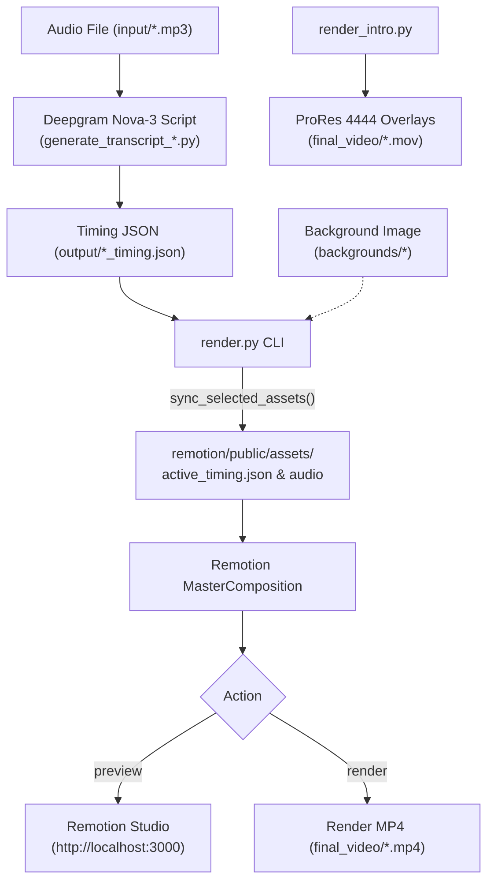

# 🌲 Project File Tree & Codebase Structure

This document outlines the architecture, directory hierarchy, and key file responsibilities for the **Lyrics Automate** repository. It is designed to be concise, easy to read, and focused on essential information.

---

## 🗺️ High-Level Directory Map

```text
Lyrics_Automate_Project/
├── 📁 backgrounds/                       # Custom background images for templates
├── 📁 final_video/                       # Exported lyric videos (.mp4) and overlays (.mov)
├── 📁 input/                             # Input song files (.mp3)
├── 📁 output/                            # Word-level timestamp JSON files (*_timing.json)
├── 📁 Partitioned/                       # Pre-packaged song bundles (audio, srt, overlays)
├── 📁 remotion/                          # Remotion React video rendering engine
│   ├── 📁 public/                        # Static assets served to Remotion
│   │   ├── 📁 assets/                    # Active audio & active_timing.json
│   │   └── 📁 backgrounds/               # Copied background images for rendering
│   └── 📁 src/                           # React + TypeScript source code
│       ├── 📁 components/                # Shared visual components (Watermark)
│       ├── 📁 shared/                    # Core utilities, state engines, types & animations
│       └── 📁 templates/                 # 7 modular lyric video templates
│           ├── 📁 Backgrounds/           # Frosted glass player with custom background image
│           ├── 📁 Energetic/             # Cyberpunk electric beat pulse template
│           ├── 📁 FeelGood/              # Warm golden-hour floating bokeh template
│           ├── 📁 JustLyrics/            # Minimalist typography overlay with Google Fonts
│           ├── 📁 Rap/                   # Kinetic burst typography for hip-hop
│           ├── 📁 Sad/                   # Deep navy melancholic serif typography
│           └── 📁 VerticalGlass/         # Modern glassmorphic player card
├── 📄 generate_transcript_english_v2.py  # Deepgram transcription script for English songs
├── 📄 generate_transcript_tamil_v2.py    # Deepgram transcription script for Tamil songs
├── 📄 render.py                          # Primary CLI for staging, previewing & rendering MP4
├── 📄 render_intro.py                    # Exporter for transparent ProRes 4444 overlays
├── 📄 requirements.txt                   # Python package dependencies
├── 📄 README.md                          # Main project guide and documentation
├── 📄 filetree.md                        # Codebase structure reference (this file)
└── 📄 .env                               # API keys (Deepgram, etc.)
```

---

## 📂 Detailed Folder & File Breakdown

### 1. Root Scripts & Configuration
| File / Folder | Role & Description |
| :--- | :--- |
| [render.py](file:///d:/Lyrics_Automate/Lyrics_Automate_Project/render.py) | **Main entrypoint CLI**. Handles interactive selection or direct CLI flags (`--song`, `--json`, `--template`, `--bg-image`, `--color`, `--font-family`, `--font-size`, `--action`). Stages assets into Remotion and triggers Preview (Studio) or Render (MP4). |
| [render_intro.py](file:///d:/Lyrics_Automate/Lyrics_Automate_Project/render_intro.py) | **Transparent overlay renderer**. Exports Apple ProRes 4444 `.mov` files with an alpha channel (`WatermarkOnly` and `IntroOnly`) for video editors like CapCut, Premiere, or DaVinci Resolve. |
| [generate_transcript_english_v2.py](file:///d:/Lyrics_Automate/Lyrics_Automate_Project/generate_transcript_english_v2.py) | Transcribes English MP3s using Deepgram **Nova-3** (`language="en"`), producing word-level timestamps in `output/<song>_timing.json`. |
| [generate_transcript_tamil_v2.py](file:///d:/Lyrics_Automate/Lyrics_Automate_Project/generate_transcript_tamil_v2.py) | Transcribes Tamil MP3s using Deepgram **Nova-3** (`language="ta"`), producing word-level timestamps in `output/<song>_timing.json`. |
| [requirements.txt](file:///d:/Lyrics_Automate/Lyrics_Automate_Project/requirements.txt) | Python dependencies: `deepgram-sdk>=5,<6` and `python-dotenv>=1.0,<2`. |
| [.env](file:///d:/Lyrics_Automate/Lyrics_Automate_Project/.env) | Environment credentials containing `DEEPGRAM_API_KEY`. |
| [.gitignore](file:///d:/Lyrics_Automate/Lyrics_Automate_Project/.gitignore) | Ignores virtual envs, `.env`, temporary media staging, and large video renders. |

---

### 2. Media & Data Directories
| Directory | Contents & Purpose |
| :--- | :--- |
| `input/` | Raw `.mp3` audio files to be processed and animated. |
| `output/` | Word-level timing files (`*_timing.json`) containing word arrays with `start`, `end`, and `text`. Can be edited for spelling or timing tweaks before rendering. |
| `backgrounds/` | Library of high-resolution portrait background images (`.png`, `.jpg`, `.webp`) used by `backgrounds`, `verticalglass`, and `justlyrics`. |
| `final_video/` | Output folder for rendered 1080x1920 MP4 lyric videos and transparent ProRes 4444 `.mov` overlay files. |
| `Partitioned/` | Organized project folders for standalone song packages (e.g., `Partitioned/Pesamale/` with audio, lyrics `.srt`, cover image, and pre-rendered transparent overlays). |

---

### 3. Remotion Engine (`remotion/`)
The video rendering engine built with **React 19**, **TypeScript**, and **Remotion 4.0** with **Rspack** support.

#### Core Configuration
* [remotion/package.json](file:///d:/Lyrics_Automate/Lyrics_Automate_Project/remotion/package.json) — NPM dependencies: `@remotion/cli`, `@remotion/google-fonts`, `@remotion/media-utils`, `lucide-react`, `react`, `remotion`.
* [remotion/remotion.config.ts](file:///d:/Lyrics_Automate/Lyrics_Automate_Project/remotion/remotion.config.ts) — Remotion CLI configuration: enables Rspack compilation and JPEG frame caching.
* [remotion/tsconfig.json](file:///d:/Lyrics_Automate/Lyrics_Automate_Project/remotion/tsconfig.json) — TypeScript compiler configuration.

#### Public Staging (`remotion/public/`)
* `public/assets/` — Holds the actively selected song MP3 and the synced `active_timing.json` (plus fallback default data).
* `public/backgrounds/` — Background images copied dynamically during `render.py` execution so Remotion's web server can serve them.

#### Core Source (`remotion/src/`)
| File | Purpose |
| :--- | :--- |
| [index.ts](file:///d:/Lyrics_Automate/Lyrics_Automate_Project/remotion/src/index.ts) | Remotion entrypoint; calls `registerRoot(RemotionRoot)`. |
| [Root.tsx](file:///d:/Lyrics_Automate/Lyrics_Automate_Project/remotion/src/Root.tsx) | Registers Remotion compositions: `LyricsVideo` (dynamic metadata calculation via `active_timing.json`), `IntroOnly` (6s standalone intro animation), and `WatermarkOnly` (45s standalone watermark). |
| [MasterComposition.tsx](file:///d:/Lyrics_Automate/Lyrics_Automate_Project/remotion/src/MasterComposition.tsx) | Master orchestrator. Dynamically renders only the chosen template component and attaches the `Watermark` in the appropriate position (top or bottom). |

#### Shared Modules (`remotion/src/shared/` & `remotion/src/components/`)
| File | Role |
| :--- | :--- |
| [components/Watermark.tsx](file:///d:/Lyrics_Automate/Lyrics_Automate_Project/remotion/src/components/Watermark.tsx) | Animated channel watermark badge with YouTube icon, smooth entrance animation, and top/bottom positioning. |
| [shared/types.ts](file:///d:/Lyrics_Automate/Lyrics_Automate_Project/remotion/src/shared/types.ts) | TypeScript interfaces: `LyricWord`, `LyricsData`, `ActiveLyricsState`, `WordCluster`, `CompositionProps`, and `TemplateName`. |
| [shared/lyrics.ts](file:///d:/Lyrics_Automate/Lyrics_Automate_Project/remotion/src/shared/lyrics.ts) | Lyric timing calculations: `getActiveLyricsState` (identifies active word, upcoming word, progress), time formatting, and `groupWordsIntoClusters` for rap burst pacing. |
| [shared/utils.ts](file:///d:/Lyrics_Automate/Lyrics_Automate_Project/remotion/src/shared/utils.ts) | Color math utilities: `hexToRgb`, `relativeLuminance`, and `resolveIntroTextColor` (chooses white or black intro text based on background luminance). |
| [shared/IntroAnimation.tsx](file:///d:/Lyrics_Automate/Lyrics_Automate_Project/remotion/src/shared/IntroAnimation.tsx) | iOS-style control sliders (Brightness decreases, Volume increases) displayed during the instrumental intro before `words[0].start`. |
| [shared/IntroOnly.tsx](file:///d:/Lyrics_Automate/Lyrics_Automate_Project/remotion/src/shared/IntroOnly.tsx) | Standalone 6-second composition rendering the intro sliders on a transparent canvas for ProRes export. |
| [shared/WatermarkOnly.tsx](file:///d:/Lyrics_Automate/Lyrics_Automate_Project/remotion/src/shared/WatermarkOnly.tsx) | Standalone 45-second composition rendering the watermark on a transparent canvas for ProRes export. |

---

### 4. Visual Templates (`remotion/src/templates/`)

All templates are registered in [templates/registry.ts](file:///d:/Lyrics_Automate/Lyrics_Automate_Project/remotion/src/templates/registry.ts).

```text
remotion/src/templates/
├── registry.ts                     # Maps template slugs to components & defines watermark positions
├── 📁 Sad/                         # Melancholic atmosphere with serif typography
│   ├── SadVideo.tsx                # Composition assembler
│   ├── SadBackground.tsx           # Subtle ambient lighting & particles
│   ├── SadHeader.tsx               # Track title & language badge
│   ├── SadLyrics.tsx               # Word-level highlight animation
│   ├── SadProgress.tsx             # Linear track progress bar
│   └── config.ts                   # Colors, font families & dimensions
├── 📁 Rap/                         # Energetic hip-hop kinetic typography
│   ├── RapVideo.tsx                # Composition assembler
│   ├── RapBackground.tsx           # Industrial dark grunge aesthetic
│   ├── RapLyrics.tsx               # Rapid cluster animations & punchy highlights
│   └── config.ts                   # Neon accents & layout config
├── 📁 FeelGood/                    # Warm golden-hour sunset theme
│   ├── FeelGoodVideo.tsx           # Composition assembler
│   ├── FeelGoodBackground.tsx      # Floating bokeh light particles
│   ├── FeelGoodLyrics.tsx          # Soft glowing typography transitions
│   └── config.ts                   # Amber/gold palette settings
├── 📁 Energetic/                   # Cyberpunk / club party aesthetic
│   ├── EnergeticVideo.tsx          # Composition assembler
│   ├── EnergeticBackground.tsx     # Cyan & magenta dynamic light pulses
│   ├── EnergeticLyrics.tsx         # High-contrast reactive text
│   └── config.ts                   # Neon color rules & beat timings
├── 📁 Backgrounds/                 # Custom image with frosted glass player card
│   ├── BackgroundsVideo.tsx        # Composition assembler
│   ├── BackgroundImage.tsx         # Scaled background image with subtle zoom
│   ├── FrostedGlassMusicPlayer.tsx # Glassmorphic player card with track controls & lyrics
│   ├── Icons.tsx                   # Player control SVG icons
│   ├── theme.ts                    # Glassmorphism styling rules
│   └── config.ts                   # Layout sizing & lyric settings
├── 📁 VerticalGlass/               # Modern minimal glass card player
│   ├── VerticalGlassVideo.tsx      # Composition assembler
│   ├── VerticalGlassBackground.tsx # Blur/vignette background container
│   ├── VerticalGlassMusicPlayer.tsx# Compact vertical glass card with lyric stream
│   ├── Icons.tsx                   # Minimal player icons
│   ├── theme.ts                    # Translucent glass presets & shadows
│   └── config.ts                   # Player dimensions & typography tokens
└── 📁 JustLyrics/                  # Pure typography focus overlay
    ├── JustLyricsVideo.tsx         # Composition assembler
    ├── JustLyricsView.tsx          # Dynamic responsive text container
    ├── GoogleFontLoader.tsx        # Dynamic Google Font loader via @remotion/google-fonts
    └── config.ts                   # Default fonts & styling configuration
```

---

## 🔄 End-to-End Execution Flow


